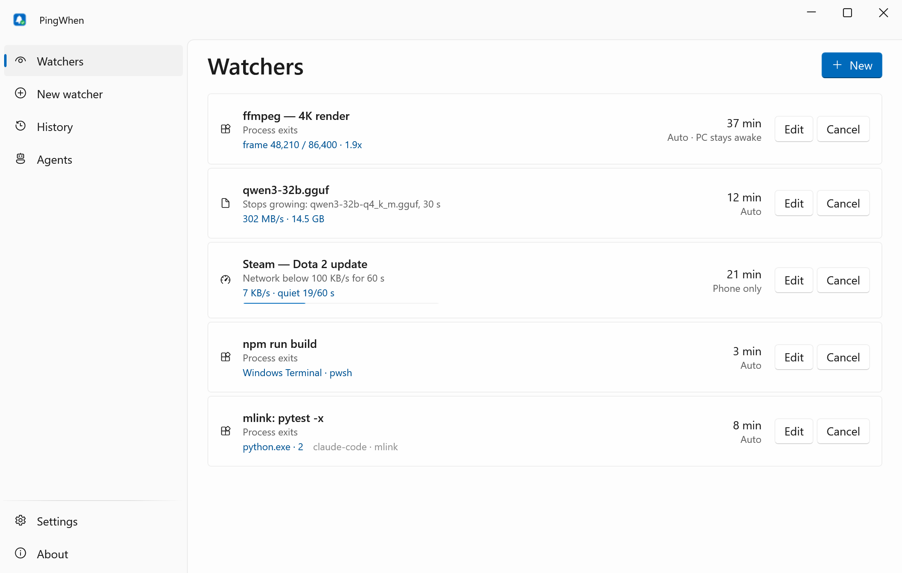
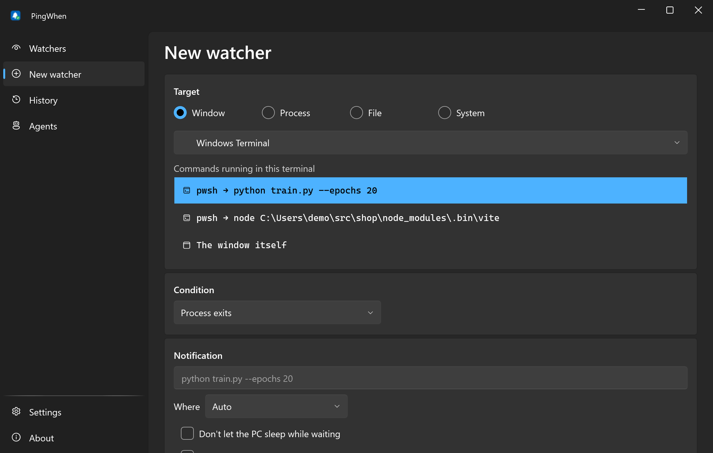
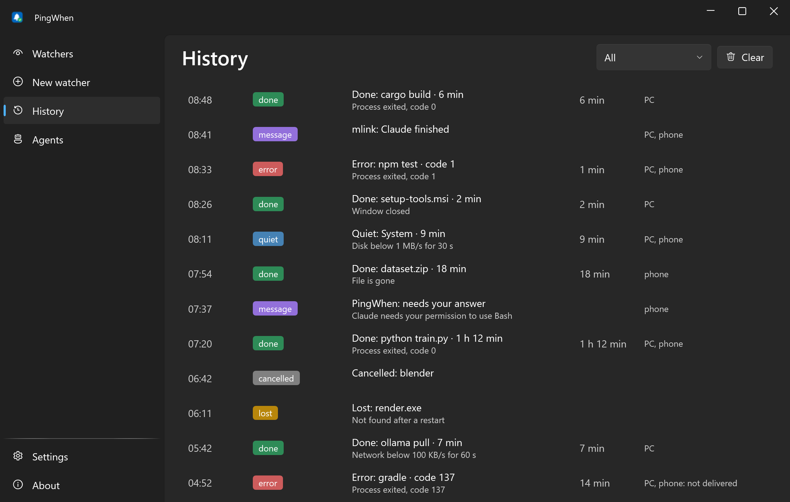
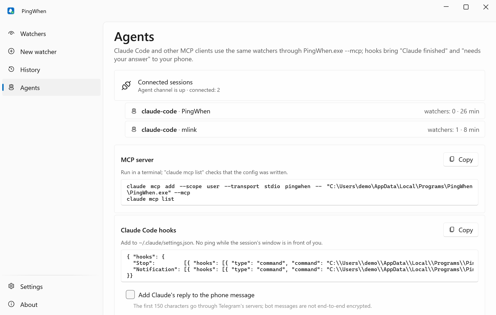
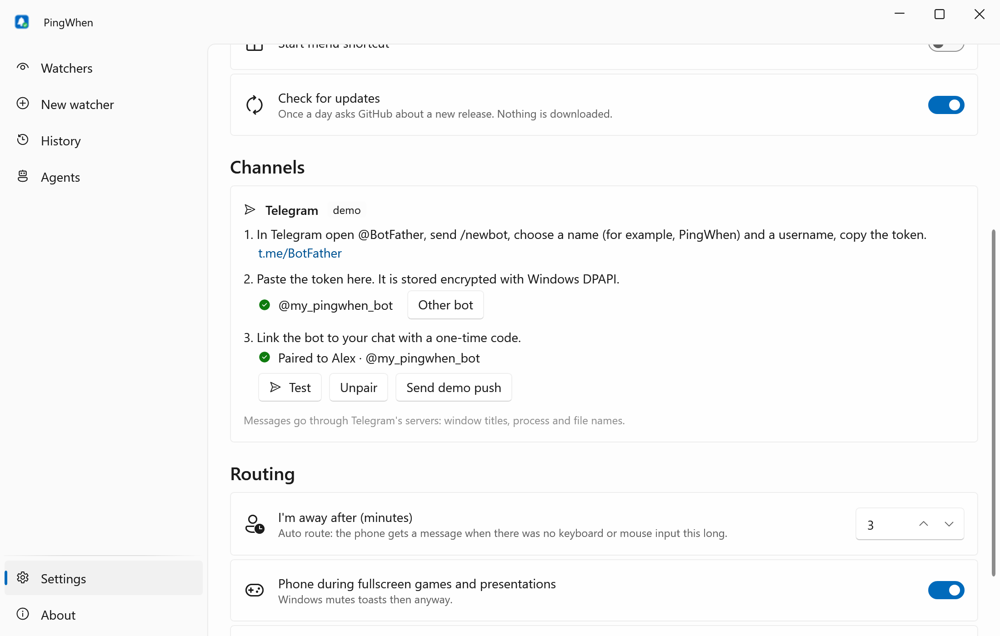

<div align="center">


# PingWhen

**Stop babysitting progress bars: a toast or a Telegram ping when the job is done.**

**English** · [Русский](README.ru.md)

[](https://github.com/lojekq/PingWhen/releases/latest)
[](https://github.com/lojekq/PingWhen/releases)
[](https://github.com/lojekq/PingWhen/actions/workflows/ci.yml)

[](LICENSE)

<picture>
  <source media="(prefers-color-scheme: dark)" srcset="docs/main-dark-en.png">
  
</picture>
</div>

## Why

A render, a model download, a build or a training run takes 40 minutes, and you keep alt-tabbing back to check.
PingWhen watches the process, window, file or load for you and pings your PC, or your phone when you are away
or in a fullscreen game. Your AI agents get the same engine: "Claude finished" and "Claude needs permission" reach your phone.

## Features

- **Any window, one hotkey** — `Ctrl+Alt+W`: process exit (with exit code), window closed or title changed, file stopped growing, CPU/GPU/disk/network gone quiet.
- **Terminal-aware** — watches the command running inside Windows Terminal or VS Code, not the terminal itself.
- **PC or phone** — a toast while you are at the PC; a Telegram message from your own bot when you are away or in a fullscreen game. Setup takes two minutes.
- **Built for AI agents** — an MCP server and Claude Code hooks: agents start watchers and send notifications; "done" and "needs your answer" come by themselves.
- **Survives restarts and sleep** — watchers are saved, pids are checked by start time, quiet timers restart after wake; optionally keeps the PC awake while waiting.
- **Local-only** — no account, no telemetry, no admin rights, no author's server. The bot is yours; its token is encrypted with Windows DPAPI.

Planned for v1.0: region watch with pixel diff and Windows OCR, screenshots in notifications, ntfy as a second channel, Allow once / Deny buttons for Claude Code permission prompts.

## Screenshots

| | |
|---|---|
|  |  |
|  |  |

## Download

1. Get **`PingWhen-x.y.z-win-x64.exe`** from [Releases](https://github.com/lojekq/PingWhen/releases/latest). Single file, no install, no admin.
2. Smaller build: `PingWhen-x.y.z-win-x64-fd.zip` (needs [.NET Desktop Runtime 10](https://dotnet.microsoft.com/download/dotnet/10.0)).
3. Optional check: `gh attestation verify <file> -R lojekq/PingWhen` or compare with `SHA256SUMS.txt`.

Requirements: Windows 11 x64. Windows 10 22H2 should work but is not tested.

## First run

1. Put the exe into a permanent folder: `%LOCALAPPDATA%\Programs\PingWhen\`. Autostart, the Start menu shortcut and the agent commands point to it.
2. Start it. Windows may show a SmartScreen warning (see FAQ). PingWhen lives in the tray; turn on **Start with Windows** in Settings.
3. Press `Ctrl+Alt+W` in the window you want to watch, or use **Tell me when…** in the tray menu.

**Phone (Telegram, two minutes).** In Telegram open [@BotFather](https://t.me/BotFather), send `/newbot`, pick a name and a username, copy the token.
In PingWhen: Settings → Telegram → paste the token → **Check** → **Pair** → **Open in Telegram** → **Start** (or send the 8-character code to the bot from your phone).
The bot only sends, and only to the chat that sent the code. Use a separate bot for each PC.

**From scripts:** `npm run build && PingWhen.exe --notify "Build finished"`; title and body: `PingWhen.exe --notify "Title" "Body"`.

## AI agents (MCP and hooks)

Claude Code, Codex CLI, Cursor and Claude Desktop start `PingWhen.exe --mcp`: a tiny stdio relay to the tray over a per-user named pipe, so agents and the window share the same watchers.
The Agents page shows these commands with your real path and a Copy button:

```powershell
claude mcp add --scope user --transport stdio pingwhen -- "C:\Users\<you>\AppData\Local\Programs\PingWhen\PingWhen.exe" --mcp
claude mcp list
```

Tools: `notify`, `watch_process` (by pid, name or command line substring), `watch_file`, `watch_window`, `watch_quiet`, `list_watchers`, `cancel_watcher`.
Limits: 6 notifications a minute per session and 60 an hour; 20 watchers per session, 50 in total; agent watchers expire after 24 h.

Hooks bring "<folder>: Claude finished" and "<folder>: needs your answer" even while Claude waits for permission and cannot call a tool. Add to `~/.claude/settings.json`:

```json
{ "hooks": {
  "Stop":         [{ "hooks": [{ "type": "command", "command": "C:\\Users\\<you>\\AppData\\Local\\Programs\\PingWhen\\PingWhen.exe", "args": ["--hook"], "timeout": 10 }] }],
  "Notification": [{ "hooks": [{ "type": "command", "command": "C:\\Users\\<you>\\AppData\\Local\\Programs\\PingWhen\\PingWhen.exe", "args": ["--hook"], "timeout": 10 }] }]
}}
```

There is no ping while the session's terminal or editor is the active window and you are at the PC. `--hook` always exits 0 and prints nothing, so it never stops Claude.

## How it works

One tray process keeps the watchers, samples windows, files and performance counters once a second and waits on process handles; with no watchers it does nothing.
A router decides between a toast and the phone: it looks at keyboard and mouse idle time and at fullscreen games or presentations.
The phone channel is your own bot: PingWhen calls the Bot API directly, pairs with your chat by a one-time code and from then on only sends.

## Settings

| Setting | Default | What it does |
|---|---|---|
| Telegram | not set up | Your bot's token (DPAPI), paired chat, Test, Unpair |
| I'm away after | 3 min | Auto route: the phone gets a message after this long without input |
| Phone during fullscreen games and presentations | on | Auto route: the phone also gets it while a game or presentation is fullscreen |
| Hotkey | `Ctrl+Alt+W` | New watcher for the active window |
| Claude's reply on the phone | off | Agents page: the first 150 characters of Claude's last message in the "finished" message |
| Language, theme | Windows | English or Russian (after a restart), light or dark |
| Start with Windows, Start menu shortcut | off; on when the exe is in `%LOCALAPPDATA%\Programs\PingWhen\` | Starts in the tray |
| Check for updates | on | Once a day asks GitHub about a new release, downloads nothing |

Per watcher: **Route** Auto / PC only / Phone only / PC and phone, **Don't let the PC sleep while waiting**, **Wait for child processes too** (installers). Tray: **Do not disturb for 1 h** mutes the phone, toasts stay.
Data lives in `%APPDATA%\PingWhen`: `settings.json`, `watchers.json`, `history.jsonl` (last 500 events), `logs\`.

## FAQ

<details><summary>Windows protected your PC / SmartScreen warning</summary>

The exe is not code-signed yet, so Windows does not know the publisher. Click **More info → Run anyway**.
Every file is built by GitHub Actions from this repository; you can check it with `gh attestation verify` or `SHA256SUMS.txt`.
Smart App Control, if it is on, blocks unsigned files with no way to allow one; the only option is to turn it off.
</details>

<details><summary>My antivirus flags it</summary>

It is a false positive: no installer, no packer, no injection or keyboard hooks (the hotkey is `RegisterHotKey`). It reads other processes' names and exit codes, which some heuristics dislike.
Please report it to your antivirus vendor and open an issue with the detection name and the SHA256 of the file.
</details>

<details><summary>Telegram is blocked in my country</summary>

The toast on the PC always works. A VPN or proxy set in Windows is used automatically. ntfy as a second phone channel (also self-hosted) is planned for v1.0.
</details>

<details><summary>My bot token leaked</summary>

In @BotFather send `/revoke` for the bot, paste the new token in Settings → Telegram and pair again. Old messages stay in your chat; nobody else can send to it through PingWhen.
</details>

<details><summary>"Another program or another PC already polls this bot"</summary>

Pairing reads the bot's updates, which only one program at a time can do. Use one bot per PC; if the bot has a webhook, create a separate bot for PingWhen (PingWhen never deletes a webhook).
</details>

<details><summary>Updating while agents are connected</summary>

`--mcp` relays keep the exe busy. Close the agent sessions, or rename the old exe (Windows allows it for a running file) and put the new one next to it.
</details>

<details><summary>How do I uninstall?</summary>

Remove the `pingwhen` MCP server (`claude mcp remove pingwhen`) and the hooks, then About → **Remove data and autostart**, then delete the exe.
</details>

## Privacy

No telemetry, no account, no author's server. Network requests:
- `https://api.telegram.org/bot<your token>/…` — only when sending a message, checking the token or pairing (getMe, getUpdates, sendMessage). Messages go through Telegram's servers: watcher titles, window titles, process and file names; Claude's reply text only if you turn it on.
- `GET https://api.github.com/repos/lojekq/PingWhen/releases/latest` once a day; turn it off in Settings.

The agent pipe `\\.\pipe\PingWhen-<your SID>` is open only to your Windows account. Agents can notify and watch (metadata only); they cannot read files or change settings.
Logs contain no window titles, paths, command lines or tokens.

## Build from source

```powershell
winget install Microsoft.DotNet.SDK.10
git clone https://github.com/lojekq/PingWhen
cd PingWhen
dotnet run --project src/PingWhen
dotnet test
```

## License

MIT © 2026 lojekq
