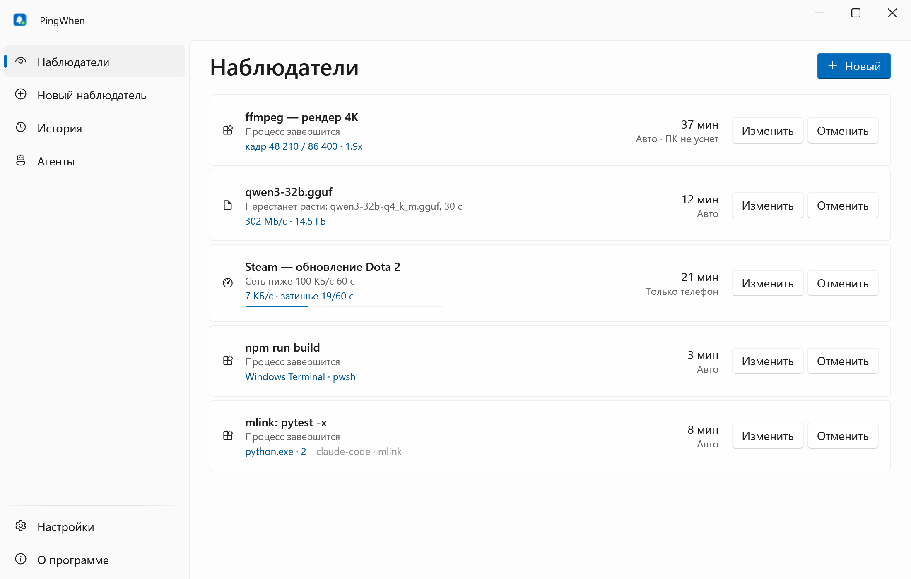
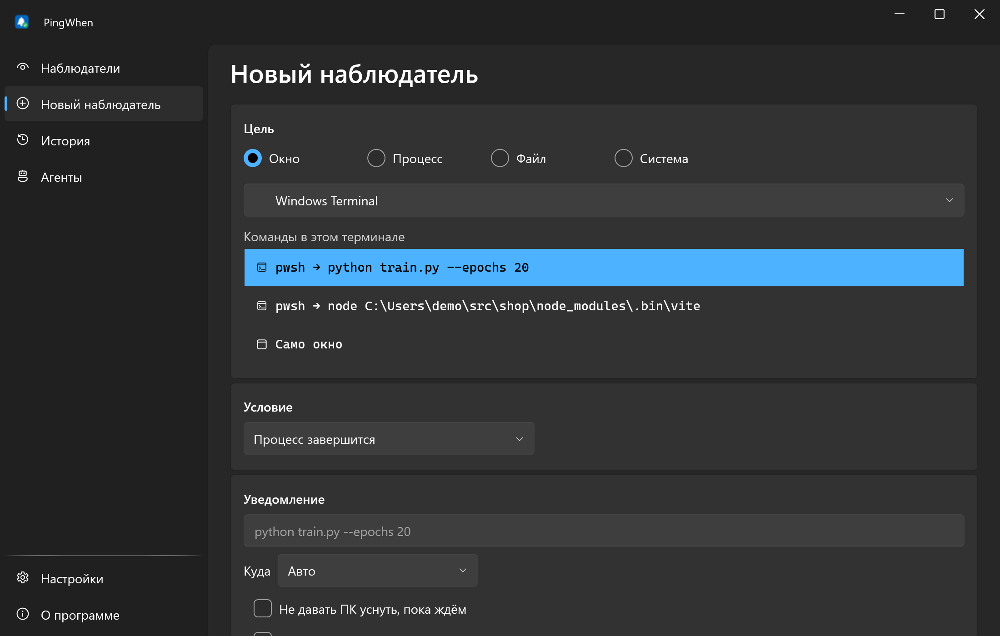
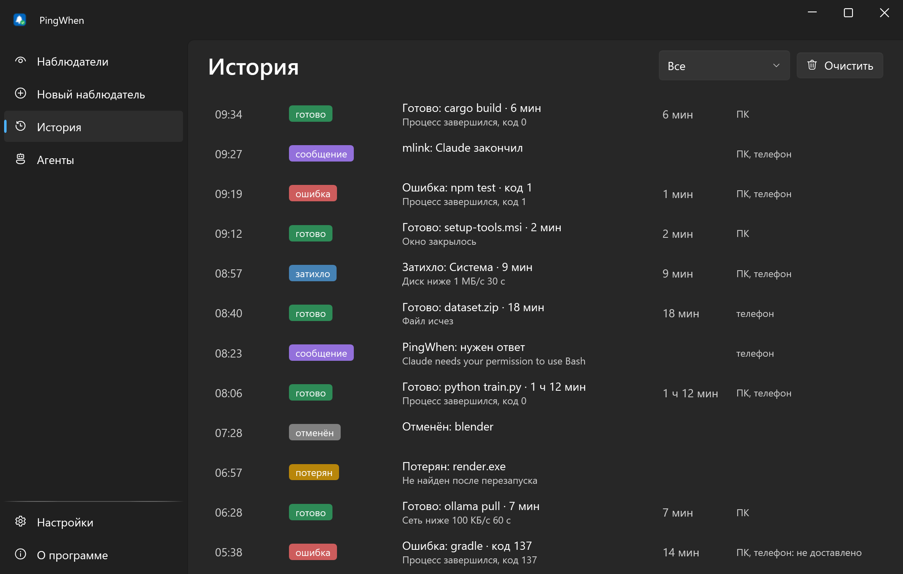
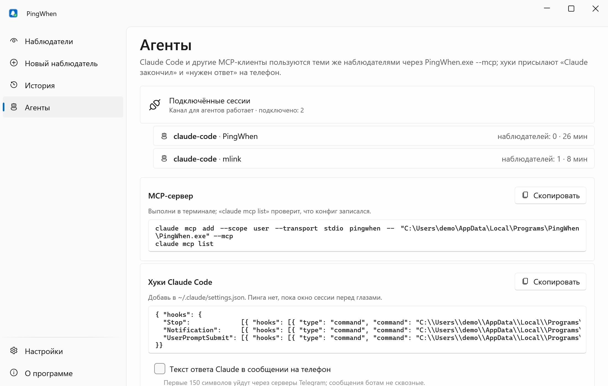
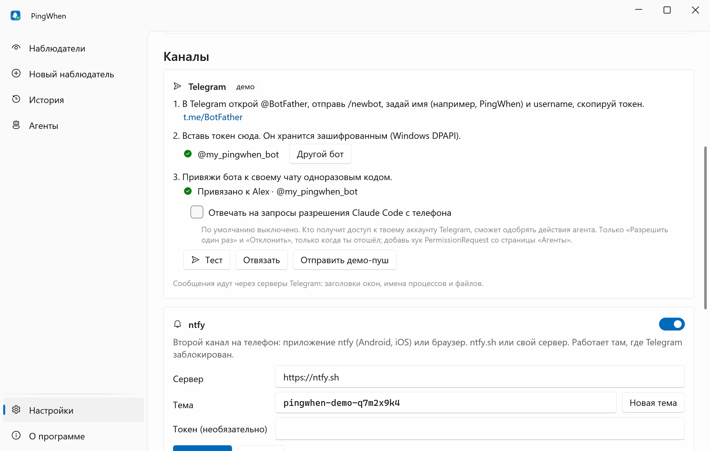

<div align="center">


# PingWhen

**Хватит караулить прогресс-бары: тост или сообщение в Telegram, когда дело сделано.**

[English](README.md) · **Русский**

[](https://github.com/lojekq/PingWhen/releases/latest)
[](https://github.com/lojekq/PingWhen/releases)
[](https://github.com/lojekq/PingWhen/actions/workflows/ci.yml)

[](LICENSE)

<picture>
  <source media="(prefers-color-scheme: dark)" srcset="docs/main-dark-ru.png">
  
</picture>
</div>

## Зачем

Рендер, загрузка модели, сборка или обучение идут 40 минут, и ты то и дело переключаешься проверить.
PingWhen следит за процессом, окном, файлом или нагрузкой и сообщает на ПК, а если тебя нет за компьютером или идёт
полноэкранная игра — на телефон. AI-агенты пользуются тем же движком: «Claude закончил» и «Claude ждёт разрешения» приходят на телефон.

## Возможности

- **Любое окно, один хоткей** — `Ctrl+Alt+W`: процесс завершился (с кодом выхода), окно закрылось или сменило заголовок, файл перестал расти, CPU/GPU/диск/сеть затихли.
- **Понимает терминалы** — следит за командой внутри Windows Terminal или VS Code, а не за самим терминалом.
- **Область окна** — обведи часть окна: «перестала меняться», «изменилась» или «появился текст 100%» (OCR Windows), даже если окно перекрыто другими.
- **ПК или телефон** — тост, пока ты за компьютером; сообщение от твоего бота в Telegram или ntfy, когда отошёл или играешь, по желанию со скриншотом.
- **Для AI-агентов** — MCP-сервер и хуки Claude Code: «готово» и «нужен ответ» приходят на телефон; по желанию кнопки «Разрешить один раз» / «Отклонить» отвечают на запрос разрешения прямо из Telegram.
- **Каждый раз, дедлайн, мигание** — повторяющиеся наблюдатели («каждый раз, когда завершается ffmpeg»), «не готово за 30 мин», мигание кнопки на панели задач.
- **Только локально** — без аккаунта, телеметрии, прав администратора и сервера автора. Бот твой, токены зашифрованы Windows DPAPI.

## Скриншоты

| | |
|---|---|
|  |  |
|  |  |

## Скачать

1. Возьми **`PingWhen-x.y.z-win-x64.exe`** в [Releases](https://github.com/lojekq/PingWhen/releases/latest). Один файл, без установки и без прав администратора.
2. Сборка поменьше: `PingWhen-x.y.z-win-x64-fd.zip` (нужен [.NET Desktop Runtime 10](https://dotnet.microsoft.com/download/dotnet/10.0)).
3. Проверка по желанию: `gh attestation verify <файл> -R lojekq/PingWhen` или сравни с `SHA256SUMS.txt`.

Требования: Windows 11 x64. Windows 10 22H2 должна работать, но не тестируется.

## Первый запуск

1. Положи exe в постоянную папку: `%LOCALAPPDATA%\Programs\PingWhen\`. На неё указывают автозапуск, ярлык в «Пуске» и команды для агентов.
2. Запусти. Windows может показать предупреждение SmartScreen (см. «Вопросы»). PingWhen живёт в трее; включи **Запускать вместе с Windows** в настройках.
3. Нажми `Ctrl+Alt+W` в окне, за которым нужно следить, или выбери **Скажи, когда…** в меню трея.

**Телефон (Telegram, две минуты).** В Telegram открой [@BotFather](https://t.me/BotFather), отправь `/newbot`, задай имя и username, скопируй токен.
В PingWhen: Настройки → Telegram → вставь токен → **Проверить** → **Привязать** → **Открыть в Telegram** → **Start** (или отправь боту 8-символьный код с телефона).
Бот только отправляет и только в тот чат, откуда пришёл код. Для каждого ПК — свой бот.
Если Telegram заблокирован, включи **ntfy** в настройках: случайная тема на ntfy.sh или своём сервере, подписка — QR-кодом в приложении ntfy.

**Область окна:** Новый наблюдатель → окно → «Область перестанет меняться» (или «изменится», «В области появится текст») → **Выбрать область…** → обведи мышью прогресс-бар.
Окно можно перекрывать другими; свёрнутое окно ставит слежение на паузу. Распознавание текста работает на установленных языках OCR Windows.

**Из скриптов:** `npm run build && PingWhen.exe --notify "Сборка готова"`; заголовок и текст: `PingWhen.exe --notify "Заголовок" "Текст"`.

## AI-агенты (MCP и хуки)

Claude Code, Codex CLI, Cursor и Claude Desktop запускают `PingWhen.exe --mcp`: крошечный stdio-ретранслятор к трею через named pipe текущего пользователя, поэтому у агентов и окна одни и те же наблюдатели.
Страница «Агенты» показывает эти команды с твоим настоящим путём и кнопкой «Скопировать»:

```powershell
claude mcp add --scope user --transport stdio pingwhen -- "C:\Users\<you>\AppData\Local\Programs\PingWhen\PingWhen.exe" --mcp
claude mcp list
```

Инструменты: `notify`, `watch_process` (по PID, имени или подстроке командной строки), `watch_file`, `watch_window` (закрылось, заголовок, мигание), `watch_quiet`, `list_watchers`, `cancel_watcher`; у watch-инструментов есть `repeat` и `deadline_minutes`.
Лимиты: 6 уведомлений в минуту на сессию и 60 в час; 20 наблюдателей на сессию, 50 всего; наблюдатели агентов истекают через 24 ч.

Хуки присылают «<папка>: Claude закончил» и «<папка>: нужен ответ», даже пока Claude ждёт разрешения и не может вызвать инструмент. Добавь в `~/.claude/settings.json` (на странице «Агенты» он уже с твоим путём):

```json
{ "hooks": {
  "Stop":             [{ "hooks": [{ "type": "command", "command": "C:\\Users\\<you>\\AppData\\Local\\Programs\\PingWhen\\PingWhen.exe", "args": ["--hook"], "timeout": 10 }] }],
  "Notification":     [{ "hooks": [{ "type": "command", "command": "C:\\Users\\<you>\\AppData\\Local\\Programs\\PingWhen\\PingWhen.exe", "args": ["--hook"], "timeout": 10 }] }],
  "UserPromptSubmit": [{ "hooks": [{ "type": "command", "command": "C:\\Users\\<you>\\AppData\\Local\\Programs\\PingWhen\\PingWhen.exe", "args": ["--hook"], "timeout": 10 }] }]
}}
```

Пинга нет, пока терминал или редактор этой сессии — активное окно и ты за компьютером. `UserPromptSubmit` позволяет не присылать «закончил» после коротких ходов (страница «Агенты»). `--hook` всегда выходит с кодом 0 и ничего не печатает, поэтому Claude не застрянет.

**Ответ с телефона (по желанию).** Настройки → Telegram → «Отвечать на запросы разрешения Claude Code с телефона» добавляет в JSON хук `PermissionRequest` (timeout 150).
Пока ты отошёл, запрос приходит в Telegram с кнопками **Разрешить один раз** и **Отклонить**; нет ответа 2 минуты — Claude покажет обычный диалог. Нажать может только привязанный аккаунт; «разрешать всегда» и ввода текста нет.

## Как это устроено

Один процесс в трее хранит наблюдателей, раз в секунду опрашивает окна, файлы и счётчики производительности и ждёт процессы на хэндлах; без наблюдателей он ничего не делает.
Маршрутизатор выбирает между тостом и телефоном: смотрит, давно ли не было ввода, и не идёт ли полноэкранная игра или презентация.
Телефонный канал — твой собственный бот: PingWhen вызывает Bot API напрямую, привязывается к чату одноразовым кодом и дальше только отправляет.

## Настройки

| Настройка | По умолчанию | Что делает |
|---|---|---|
| Telegram | не настроен | Токен твоего бота (DPAPI), привязанный чат, «Тест», «Отвязать» |
| ntfy | выкл | Сервер (ntfy.sh или свой), случайная тема, токен по желанию (DPAPI), «Тест», QR для подписки |
| Отвечать на запросы разрешения с телефона | выкл | Кнопки Telegram «Разрешить один раз» / «Отклонить» для Claude Code, только когда ты отошёл |
| Считать, что я отошёл, через | 3 мин | Маршрут «Авто»: на телефон, если столько не было ввода |
| Телефон во время полноэкранных игр и презентаций | вкл | Маршрут «Авто»: на телефон и во время полноэкранной игры или презентации |
| Хоткей | `Ctrl+Alt+W` | Новый наблюдатель для активного окна |
| Текст ответа Claude на телефон | выкл | Страница «Агенты»: первые 150 символов последнего ответа Claude в сообщении «закончил» |
| «Claude закончил» только после хода не короче | 0 с | Страница «Агенты»: пропускать короткие ходы (нужен хук `UserPromptSubmit`) |
| Язык, тема | как в Windows | Русский или английский (после перезапуска), светлая или тёмная |
| Запуск вместе с Windows, ярлык в «Пуске» | выкл; ярлык вкл, если exe в `%LOCALAPPDATA%\Programs\PingWhen\` | Запуск в трей |
| Проверять обновления | вкл | Раз в день спрашивает GitHub о новом релизе, ничего не скачивает |

У наблюдателя: **Куда** — Авто / Только ПК / Только телефон / ПК и телефон, **Не давать ПК уснуть, пока ждём**, **Ждать и дочерние процессы** (установщики), **Каждый раз**, **Приложить скриншот окна** (выкл), **Сообщить, если не готово за N минут**. В трее: **Не беспокоить 1 ч** — телефон молчит, тосты остаются.
Данные лежат в `%APPDATA%\PingWhen`: `settings.json`, `watchers.json`, `history.jsonl` (последние 500 событий), `logs\`.

## Вопросы

<details><summary>Windows защитила компьютер / предупреждение SmartScreen</summary>

Exe пока не подписан, поэтому Windows не знает издателя. Нажми **Подробнее → Выполнить в любом случае**.
Каждый файл собирает GitHub Actions из этого репозитория; проверить можно через `gh attestation verify` или `SHA256SUMS.txt`.
Smart App Control, если он включён, блокирует неподписанные файлы без возможности разрешить; остаётся только его выключить.
</details>

<details><summary>Антивирус ругается</summary>

Это ложное срабатывание: нет установщика, упаковщика, инъекций и перехвата клавиатуры (хоткей — `RegisterHotKey`). Программа читает имена и коды выхода чужих процессов, это не нравится некоторым эвристикам.
Сообщи о ложном срабатывании производителю антивируса и открой issue с названием детекта и SHA256 файла.
</details>

<details><summary>Telegram заблокирован в моей стране</summary>

Тост на ПК работает всегда. Включи ntfy в настройках (ntfy.sh или свой сервер). VPN или прокси, настроенные в Windows, подхватываются для обоих каналов сами.
</details>

<details><summary>Вокруг окна жёлтая рамка или текст в области не находится</summary>

На сборках старше Windows 11 24H2 Windows рисует жёлтую рамку вокруг захватываемого окна; на новых PingWhen её отключает.
«Появится текст» нужен язык OCR Windows (Параметры → Время и язык → Язык: язык с оптическим распознаванием). Свёрнутое окно не даёт изображения — слежение на паузе.
</details>

<details><summary>Безопасно ли отвечать Claude с телефона?</summary>

Кто управляет твоим аккаунтом Telegram, тот может одобрять действия агента, поэтому по умолчанию выключено. Нажатие засчитывается только от привязанного аккаунта, один раз и пока запрос ждёт; «разрешать всегда» нет.
</details>

<details><summary>Токен бота утёк</summary>

В @BotFather отправь `/revoke` для этого бота, вставь новый токен в Настройки → Telegram и привяжи заново. Старые сообщения останутся в чате; через PingWhen писать в него больше никто не сможет.
</details>

<details><summary>«Этого бота уже опрашивает другая программа или другой ПК»</summary>

При привязке PingWhen читает входящие сообщения бота, а это одновременно может делать только одна программа. Заведи по боту на каждый ПК; если у бота настроен webhook, создай для PingWhen отдельного бота (PingWhen никогда не удаляет webhook).
</details>

<details><summary>Обновление, пока подключены агенты</summary>

Ретрансляторы `--mcp` держат exe занятым. Закрой сессии агентов или переименуй старый exe (Windows разрешает это для запущенного файла) и положи новый рядом.
</details>

<details><summary>Как удалить?</summary>

Убери MCP-сервер `pingwhen` (`claude mcp remove pingwhen`) и хуки, затем «О программе» → **Удалить данные и автозапуск** и удали exe.
</details>

## Приватность

Без телеметрии, аккаунта и сервера автора. Сетевые запросы:
- `https://api.telegram.org/bot<твой токен>/…` — только при отправке сообщения, проверке токена, привязке и ожидании кнопки разрешения (getMe, getUpdates, sendMessage, sendPhoto, answerCallbackQuery, editMessageText). Сообщения идут через серверы Telegram: заголовки наблюдателей и окон, имена процессов и файлов; текст ответа Claude, скриншоты и запросы разрешения — только если ты это включил.
- Твой сервер ntfy (по умолчанию `https://ntfy.sh`) — только если ntfy включён: те же тексты, скриншоты — если включены. Тему может прочитать любой, кто её знает.
- `GET https://api.github.com/repos/lojekq/PingWhen/releases/latest` раз в день; выключается в настройках.

Pipe для агентов `\\.\pipe\PingWhen-<твой SID>` открыт только твоей учётной записи Windows. Агенты могут уведомлять и наблюдать (только метаданные), читать файлы и менять настройки они не могут.
В логах нет заголовков окон, путей, командных строк и токенов.

## Сборка из исходников

```powershell
winget install Microsoft.DotNet.SDK.10
git clone https://github.com/lojekq/PingWhen
cd PingWhen
dotnet run --project src/PingWhen
dotnet test
```

## Лицензия

MIT © 2026 lojekq
